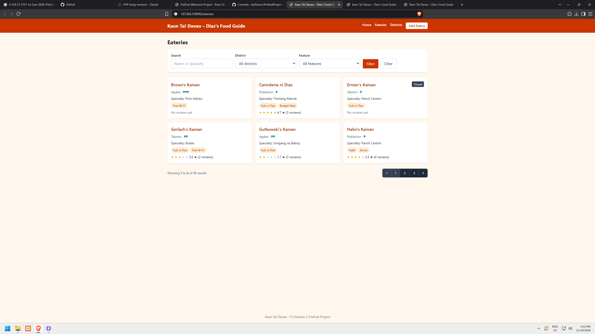
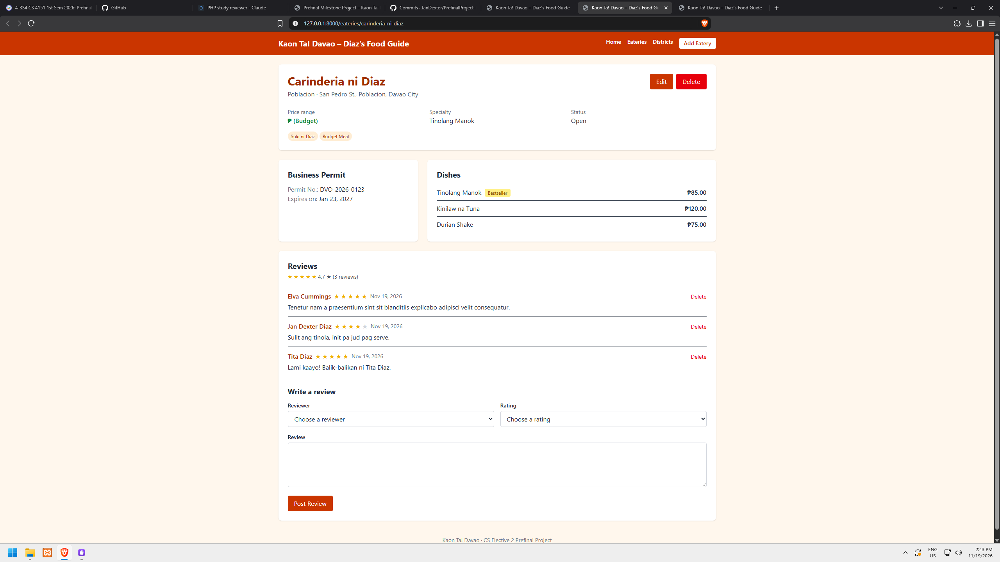
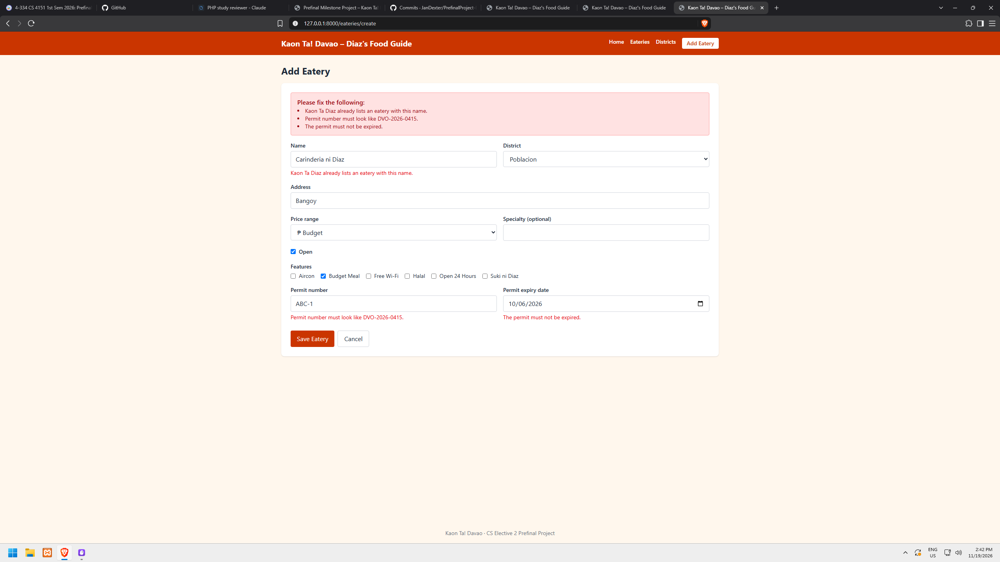

# Kaon Ta! Davao: Carinderia & Eatery Guide

**By:** Jan Dexter Diaz
**Course:** 4-334 · CS Elective 2 Full-Stack Development (Laravel) · Prefinal Milestone Project

A Laravel 12 app (SQLite) for listing Davao City eateries by district, with each eatery's business permit, dishes, features, and reviews.

## Setup

```bash
composer install
cp .env.example .env
php artisan key:generate
touch database/database.sqlite
php artisan migrate:fresh --seed
npm install
npm run build        # or npm run dev while developing
php artisan serve
```

Then open http://127.0.0.1:8000

## Personalized Data

| Item | Value |
|---|---|
| Site title | Kaon Ta! Davao – Diaz's Food Guide |
| Districts (6) | Poblacion, Talomo, Agdao, Buhangin, Toril, Calinan |
| Features (6) | Suki ni Diaz, Budget Meal, Halal, Open 24 Hours, Aircon, Free Wi-Fi |
| User 1 | Jan Dexter Diaz / diaz@kaonta.test (password: kaonta2026) |
| User 2 | Tita Diaz / tita.diaz@kaonta.test (password: kaonta2026) |
| My eatery | Carinderia ni Diaz (slug: `carinderia-ni-diaz`), Poblacion, San Pedro St., Poblacion, Davao City, budget, specialty Tinolang Manok, open |
| My eatery's features | Suki ni Diaz, Budget Meal |
| My eatery's permit | DVO-2026-0123, expires on January 23, 2027 |
| My eatery's dishes | Tinolang Manok ₱85.00 (bestseller), Kinilaw na Tuna ₱120.00, Durian Shake ₱75.00 |

Seeded totals: 6 districts, 6 features, 12 users, 15 eateries (3 closed), 15 permits.

## Relationships

| Relationship | Type | Why this type fits |
|---|---|---|
| District → Eatery | hasMany / belongsTo | One district can have many eateries, but each eatery is only in one district. |
| Eatery → Dish | hasMany / belongsTo | An eatery serves many dishes, and each dish belongs to only one eatery. |
| Eatery → Review | hasMany / belongsTo | An eatery can get many reviews, but each review is about one eatery only. |
| User → Review | hasMany / belongsTo | One user can write many reviews, and each review has one writer. |
| Eatery → Permit | hasOne / belongsTo | Each eatery has exactly one business permit, so `eatery_id` is unique in the permits table. |
| Eatery ↔ Feature | belongsToMany / belongsToMany | An eatery can have many features and a feature like Halal can be on many eateries, so they are linked by the `eatery_feature` pivot table. |
| District → Review (through Eatery) | hasManyThrough | Reviews are not connected to districts directly, so the district reaches its reviews by going through its eateries. |

## Route List

Output of `php artisan route:list --except-vendor`:

```
  GET|HEAD        / ............................................................................ home › HomeController
  GET|HEAD        districts ............................................... districts.index › DistrictController@index
  GET|HEAD        districts/{district} ...................................... districts.show › DistrictController@show
  GET|HEAD        eateries ................................................... eateries.index › EateryController@index
  POST            eateries ................................................... eateries.store › EateryController@store
  GET|HEAD        eateries/create .......................................... eateries.create › EateryController@create
  GET|HEAD        eateries/{eatery} ............................................ eateries.show › EateryController@show
  PUT|PATCH       eateries/{eatery} ........................................ eateries.update › EateryController@update
  DELETE          eateries/{eatery} ...................................... eateries.destroy › EateryController@destroy
  GET|HEAD        eateries/{eatery}/edit ....................................... eateries.edit › EateryController@edit
  POST            eateries/{eatery}/reviews .......................... eateries.reviews.store › ReviewController@store
  GET|HEAD        reviewers/{user} .......................................... reviewers.show › ReviewerController@show
  DELETE          reviews/{review} ........................................ reviews.destroy › ReviewController@destroy

                                                                                                   Showing [13] routes
```

## Screenshots

### Eatery list


### Eatery page with reviews


### Create form with validation errors

